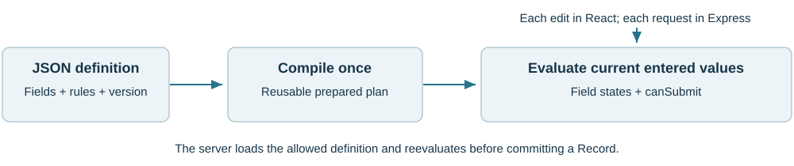
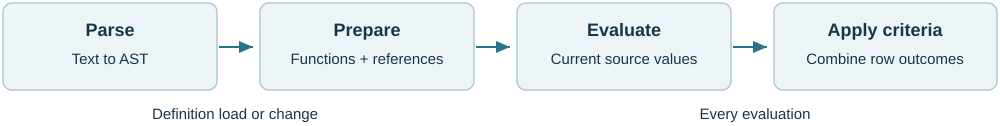

# Use one rules engine in the browser and server

DCMS Form Rules evaluates rules attached to application fields. Give it a JSON definition and entered values; it returns field results and whether validation permits Submit. The same package runs in a React bundle and in Node.js/Express.

A **Form** defines fields and rules. A **Record** contains their entered values. A **validation row** applies an optional formula and one criterion, such as "less than 105". Rows combine into a field rule.

## Where it helps

| Application need | Package behavior |
|---|---|
| Numeric limits and unit conversion | Calculate a row value, then compare it with a limit |
| Text and required phrases | Normalize text or match a literal keyword expression |
| Radio and Checkbox selections | Check allowed, required or excluded values |
| Cross-field checks | Read another field and reevaluate dependents after edits |
| Warning versus rejection | Return advisory, blocking and calculation-error states |
| Several Forms in one Record | Evaluate each Form and aggregate Submit eligibility |

## The integration pattern



Compile a definition once, then reuse its plan as the user edits. On Save or Submit, the server loads the permitted definition and evaluates the submitted values again.

The application owns controls, required-field and option checks, permissions and persistence. Formula results are used for validation; the source Record keeps what the user entered.

## What to open

From the workspace root, run `npm run pack:engine` to create `artifacts/dcms-form-rules-0.10.5.tgz`. Install that tarball in a separate consumer. The maintained engine source and examples are under `packages/form-rules/`; the approved reference is available through the workspace `/workbench/` route.

<!-- page -->
# Install and make the first call

The installed package is JavaScript. It supports ES modules and CommonJS; TypeScript declarations are optional editor/type-checking information. Use Node 22.14.0 or newer. Browser applications import the same package through their normal bundler.

Run this command in your application's directory, replacing the path with the supplied file:

```sh
npm install /path/to/dcms-form-rules-0.10.5.tgz
```

Save the following as check-temperature.mjs and run `node check-temperature.mjs`:

<!-- dcms-guide-example {"id":"GUIDE-FIRST-CALL","stdout":"true\n100\n"} -->
```js
import {compileForm, evaluateRecordPayload} from '@dcms/form-rules';

const definition = {
  formId: 'temperature', version: 1,
  fields: [{
    id: 'f', label: 'Temperature F', valueType: 'number',
    mustBeCorrect: true,
    validationRows: [{
      id: 'maximum', expression: '(VALUE-32)*5/9',
      criteria: 'number_less_than', keyword: 105
    }]
  }]
};
const plan = compileForm(definition); // reuse for this definition
const result = evaluateRecordPayload(plan, {
  formId: 'temperature', formVersion: 1, values: {f: 212}
});
console.log(result.canSubmit); // true
console.log(result.fields.f.validationRowResults[0].calculatedValue);
// 100 degrees C; result.fields.f.enteredValue is still 212.
```

For CommonJS, put the equivalent code in a .cjs file and replace the import:

```js
const {compileForm, evaluateRecordPayload} = require('@dcms/form-rules');
```

The definition and payload must name the same Form and version. Stable field IDs connect rules, values and results. `VALUE` means the entered value of the field owning the row. The calculation above converts units; the criterion then checks `100 < 105`.

Change the input to 230: the calculated value is 110 and Submit is blocked. The limit is strict: 221 F converts to exactly 105 C and also fails "less than 105". These are illustrative values, not equipment specifications.

<!-- page -->
# Integrate with React and Express

## Run the supplied example first

From the restored development workspace:

```sh
npm run build:engine
npm run example:react --workspace=@dcms/form-rules
```

Open http://127.0.0.1:32191. The screen runs React; Save and Submit call an Express endpoint. Change Pressure limit from 100 to 90: Measured pressure 95 becomes blocking. Change the measurement to 80: it passes. Remove CHECKED from the technician note to see an advisory warning.

The example is ordinary JavaScript/JSX. `npm start` bundles the React code before starting the local server. Its local user and in-memory saves are demonstration fixtures.

## In your React application

The adapter in examples/form-store.js keeps the definition, values and evaluation together. React subscribes with `useSyncExternalStore`; react-javascript/App.jsx shows the complete integration.

| React responsibility | Engine or adapter call |
|---|---|
| Load the definition and initial values | createFormStore(definition, initialValuesMap) |
| Apply an edit | store.change(fieldId, enteredValue) |
| Render a field's state and guidance | store.getField(fieldId) |
| Read current Submit eligibility | store.getEvaluation().canSubmit |
| Submit original entered values | store.payload() |
| Load a changed definition | store.replaceDefinition(nextDefinition) |

For expensive or untrusted formulas, use the browser-worker example. Disable Submit while the current result is pending. The core engine APIs are synchronous.

## In your Express application

Copy/adapt examples/express-adapter.mjs and isolated/. Mount `createRecordRouter({authorize, withRecordTransaction})` at /records. POST to /records/{recordId}/transition with `action: "draft"` or `"submit"`, plus formId, formVersion and values.

Your authorization middleware identifies the user. Your transaction callback loads the permitted definition and trusted external data, enforces concurrency, and supplies `commit`. The adapter evaluates in a Node worker and rejects invalid Submit before commit. Replace the sample server's in-memory transaction with your database implementation.

<!-- page -->
# Read the results and author the rules

## Field states

A successful API call can contain failed criteria or calculation errors. Inspect each field's evaluationState and validationState, then the aggregate canSubmit flag.

| Field outcome | Meaning | Effect on canSubmit |
|---|---|---|
| not_validated | No validation rows | Does not block |
| valid | Combined rule passes | Does not block |
| warning | Rule fails; mustBeCorrect is false | Does not block |
| blocking | Rule fails; mustBeCorrect is true | Blocks |
| evaluationState = error | A formula could not produce a usable result | Always blocks |

Use `evaluationErrorDetails` for stable codes and row/source positions. Invalid definitions or malformed payloads throw before returning a usable Record result.

The package permits correction drafts: canSave remains true for evaluated, well-formed values even when validation fails. Apply the application's Save policy before accepting a draft. A worker timeout returns no usable evaluation and must not authorize a save or submission.

## Three different kinds of expression

| Location | Example | Meaning |
|---|---|---|
| Row formula | ROUND((VALUE-32)*5/9, 1) | Calculate the value for this row |
| Required Keywords criterion | PASS AND NOT HOLD | Search text for literal terms |
| Operator before a later row | AND NOT | Combine this row's Boolean result with other rows |

Each row starts with the same entered value. A row's result never feeds the next row. The first row operator is ignored; later rows combine with NOT before AND before OR. For example, A OR B AND NOT C means A OR (B AND (NOT C)).

In keyword expressions, uppercase AND/OR/NOT are operators. Spaces between terms mean OR and produce a non-blocking authoring warning. Quoted phrases are one literal. Punctuation stays literal: OR-HOLD is simply an example code containing a hyphen, not an operator or a built-in status.

Use `FIELD("limit")` to read another field by ID. Missing values become null (BLANK), distinct from zero, false and empty text. The authored criteria determine validation; `valueType` describes the intended control.

<!-- page -->
# How the package works, and why

## Prepare definitions once

Chevrotain converts formula text into an **abstract syntax tree (AST)**: structured nodes describing literals, operators and function calls. A preparation pass resolves function names, records field references and attaches compatibility information. Repeated evaluations visit this prepared tree; they do not reparse the formula or execute JavaScript source.



Formula.js supplies enabled calculation functions behind a DCMS-controlled registry. Native arithmetic, references, lazy branches and row/keyword logic remain DCMS code. Lazy functions such as IF evaluate only the selected branch, so an unused branch cannot trigger a division-by-zero error.

## Dependencies selected for specific jobs

| Dependency | Role and reason |
|---|---|
| Chevrotain 10.5.0 | Tokenization and two explicit grammars: formulas and Required Keywords. One generic function-call rule avoids a grammar rule per function. |
| @formulajs/formulajs 4.6.1 | Reuse spreadsheet-style calculations through a fixed allow/pending policy. Upstream upgrades cannot silently expand the language. |
| Lodash 4.18.1 | A fixed transitive parsing dependency, bundled consistently with the selected runtime. It does not define rule semantics. |
| TypeScript 5.9.3 | Check the engineering source and emit matching ESM/CommonJS JavaScript and declarations. It is used at build time only. |

Date/time, randomness, worksheet context and unresolved environment/error behavior are excluded or pending. The Full Reference gives the policy and function catalog. The language does not promise full Excel compatibility.

## Evaluate only what must change

The compiler builds an index from a source field to its dependents. An edit follows that index and reevaluates affected fields. Private input snapshots also detect additional edits and mutated arrays. Changed external values or an unusable previous result cause a full reevaluation. Inputs still require checking; incremental evaluation is not constant-time for every Form.

Reuse plans by the complete definition/engine cache key, not by Form ID alone. Keep plans and results read-only. Separate Forms in a Revision have independent field scopes; the Revision layer aggregates their outcomes without inventing cross-Form dependencies.

<!-- page -->
# Change and rebuild the package

The source/ directory is a self-contained engine project: commented TypeScript modules, six focused test files, schemas, lockfile and build/packing tools. The Full Reference maps each module to its responsibility.

## First build

From source/:

```sh
npm ci
npm run verify
```

The first command installs locked dependencies. The second checks source comments, builds ESM and CommonJS, and runs the included engine tests. React, Express and a browser are not needed to build the engine.

## After an engine change

Edit src/, then add or adjust a focused test for the behavior you changed. Choose a new package/compiler version, verify and package:

```sh
node tools/set-version.mjs 0.10.6
npm run verify
npm run pack:local
```

The version command synchronizes package, lockfile and compiler identities and updates the supplied Markdown. The packing command writes release/dcms-form-rules-0.10.6.tgz in this example with runtime dependencies. Use it instead of plain npm pack so the selected Lodash version travels with the package.

## Adopt the rebuilt package

Install the new TGZ in the application and rerun relevant examples. Update the example project's local dependency if using it. Discard old compiled plans and compile from saved definitions again. Persist definitions and entered values, not executable plans.

A dependency upgrade needs a function-policy review, compatibility/version update and relevant behavior tests. Do not automatically enable newly discovered functions. Edit src/ and rebuild; JavaScript and declaration files in dist/ are outputs.

For initial integration, use the supplied engine unchanged. Establish your definitions, controls, error display, authorization and persistence first. Consult the Full Reference for API and implementation details, and the Atlas for passing and failing cases.
