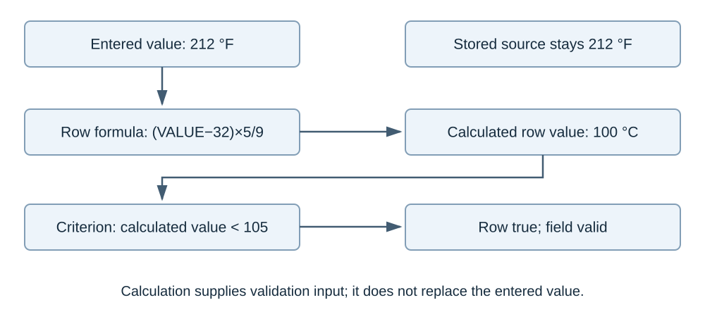
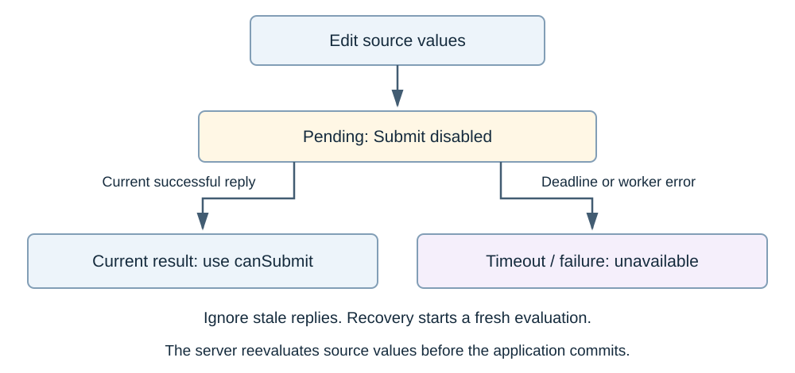

# Worked JavaScript examples

These examples run against the installed `@dcms/form-rules` package. They use ordinary JavaScript and Node's built-in assertions. A successful run exits without output. Copy a complete block into a `.mjs` file and run `node example.mjs`. `npm test` executes these exact blocks, the README quick start, both module imports and all twelve Atlas blocks. The installed-consumer qualification executes them again against the release TGZ.

## Numeric transformations and deliberate limits

The expected answers below are independent constants: 212 °F is 100 °C; the absolute magnitude of -3.5 is 3.5; the minimum of 2, 5 and -1 is -1. Rounding 2.25 to one decimal produces 2.3 in this pinned registry. A numeric string is converted by native arithmetic, while a null value is not. Formula.js wrappers have their own documented null conversions.

<!-- dcms-example {"id":"DOC-NUMBERS"} -->
```js
import assert from 'node:assert/strict';
import {evaluateFormula} from '@dcms/form-rules';
const cases = [
  ['ROUND((VALUE-32)*5/9,2)', 212, 100],
  ['ROUND(VALUE,1)', 2.25, 2.3],
  ['ABS(VALUE)', -3.5, 3.5],
  ['MIN(2,5,VALUE)', -1, -1],
  ['MAX(VALUE,5)', null, 5],
  ['SUM(VALUE,5)', null, 5],
  ['ISBLANK(VALUE)', null, true],
  ['LEN(VALUE)', null, 0],
  ['VALUE+2', '3', 5],
  ['VALUE=0', null, false],
];
for (const [formula,value,expected] of cases)
  assert.equal(evaluateFormula(formula,{value}),expected,formula);
assert.throws(() => evaluateFormula('VALUE+2',{value:null}),
  {code:'FORMULA_EXPECTED_NUMBER'});
assert.throws(() => evaluateFormula('SQRT(VALUE)',{value:-1}),
  {code:'FORMULA_MATH_ERROR'});
assert.throws(() => evaluateFormula('1/VALUE',{value:0}),
  {code:'FORMULA_DIV_ZERO'});
```

JavaScript numbers use binary floating point. These examples do not establish decimal-money precision, complete Excel compatibility or the accuracy of every upstream function over every input range. Date, clock and random functions remain outside the enabled language policy.

## Entered value, row value and final state



A row can calculate a value for validation without changing what the user entered. This example checks 212 °F as 100 °C. Its limit is strict: a calculated value of exactly 100 does not pass “less than 100.” An ordinary failed rule can warn or block according to `mustBeCorrect`; a division-by-zero error always blocks Submit.

<!-- dcms-example {"id":"DOC-STATES"} -->
```js
import assert from 'node:assert/strict';
import {compileForm,evaluateRecordPayload} from '@dcms/form-rules';
function evaluate(mustBeCorrect,expression,keyword,value) {
  const definition={formId:'states',version:1,fields:[{
    id:'temperature',label:'Temperature F',valueType:'number',mustBeCorrect,
    validationRows:[{id:'limit',expression,criteria:'number_less_than',keyword}]
  }]};
  return evaluateRecordPayload(compileForm(definition),{
    formId:'states',formVersion:1,values:{temperature:value}
  });
}
const pass=evaluate(true,'(VALUE-32)*5/9',105,212);
assert.equal(pass.fields.temperature.enteredValue,212);
assert.equal(pass.fields.temperature.validationRowResults[0].calculatedValue,100);
assert.equal(pass.fields.temperature.validationState,'valid');
assert.equal(pass.canSubmit,true);
const warning=evaluate(false,'(VALUE-32)*5/9',100,212);
assert.deepEqual(warning.warningFieldIds,['temperature']);
assert.equal(warning.canSubmit,true);
const blocked=evaluate(true,'(VALUE-32)*5/9',100,212);
assert.deepEqual(blocked.blockingFieldIds,['temperature']);
assert.equal(blocked.canSubmit,false);
const error=evaluate(false,'1/VALUE',100,0);
assert.equal(error.fields.temperature.evaluationState,'error');
assert.equal(error.fields.temperature.validationState,null);
assert.equal(error.fields.temperature.evaluationErrorDetails[0].code,'FORMULA_DIV_ZERO');
assert.equal(error.canSubmit,false);
assert.equal(error.canSave,true);
```

`canSave` reports the package's correction-draft policy. It does not grant permission, confirm persistence or resolve the conflicting FR-REC-18 wording. Authoring **Confirm**, authoring **Save Form**, and Record **Submit** are separate actions. A malformed rule definition is rejected before Record evaluation.

## Cross-field change and exact affected fields

Changing the limit reevaluates both the limit field and the measured value that depends on it. The unrelated note retains its result object. The expected affected IDs are stated explicitly rather than inferred from another evaluation path.

<!-- dcms-example {"id":"DOC-DEPENDENCY"} -->
```js
import assert from 'node:assert/strict';
import {compileForm,evaluateRecord,evaluateChangeDetailed} from '@dcms/form-rules';
const plan=compileForm({formId:'inspection',version:1,fields:[
  {id:'limit',label:'Limit',valueType:'number'},
  {id:'measured',label:'Measured',valueType:'number',mustBeCorrect:true,
    validationRows:[{id:'within',expression:'VALUE-FIELD("limit")',
      criteria:'number_less_than',keyword:0}]},
  {id:'note',label:'Note',valueType:'string'}
]});
const values=new Map([['limit',100],['measured',95],['note','CHECKED']]);
const before=evaluateRecord(plan,values);
assert.equal(before.canSubmit,true);
values.set('limit',90);
const changed=evaluateChangeDetailed(plan,values,before,'limit');
assert.deepEqual([...changed.affectedFieldIds].sort(),['limit','measured']);
assert.equal(changed.evaluation.values.get('measured').validationState,'blocking');
assert.equal(changed.evaluation.values.get('measured').enteredValue,95);
assert.equal(changed.evaluation.values.get('note'),before.values.get('note'));
assert.equal(changed.evaluation.canSubmit,false);
```

## Required Keywords use literal matching

Uppercase operators have defined precedence. Whitespace between terms means implicit OR and produces an authoring warning. Punctuation is literal; it is not a regular expression.

<!-- dcms-example {"id":"DOC-KEYWORDS"} -->
```js
import assert from 'node:assert/strict';
import {parseKeywordExpression,evaluateKeyword,diagnoseKeywordExpression}
  from '@dcms/form-rules';
const expression=parseKeywordExpression('GROUND AND (STUD OR STRAP) AND NOT MISSING');
assert.equal(evaluateKeyword(expression,'Ground stud installed',false),true);
assert.equal(evaluateKeyword(expression,'Ground strap missing',false),false);
assert.equal(evaluateKeyword(parseKeywordExpression('A.*B'),'AxxB',true),false);
assert.equal(evaluateKeyword(parseKeywordExpression('A.*B'),'A.*B',true),true);
const diagnostic=diagnoseKeywordExpression('PASS ACCEPTABLE');
assert.ok(diagnostic.warnings.some(x=>x.code==='KEYWORD_IMPLICIT_OR'));
```

## Worker state and server authority



A new edit immediately makes the asynchronous result pending and disables Submit. Only the current successful result can restore readiness. A timeout or worker failure leaves the result unavailable; a late reply from that worker cannot restore approval. Recovery requires a fresh evaluation. The server independently checks submitted source values and the application applies permissions and commits the transaction.

The runnable React/Express example demonstrates normal edits, an advisory warning, a correction draft and server rejection of an invalid direct POST. The browser qualification also exercises a real worker timeout and recovery. These are executable demonstrations; the application must supply its own authentication, database and transaction policy.
